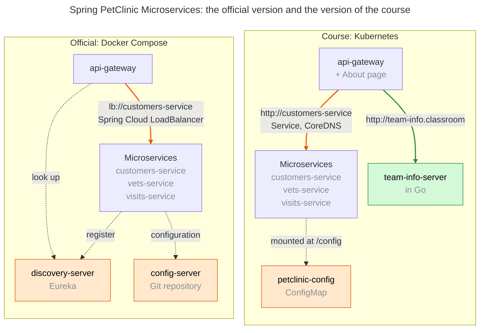

## Introduction

In the end of October, I had the privilege to go to ESIGELEC, an engineering school in Saint-Étienne-du-Rouvray, Normandy, France, to share knowledge about Kubernetes with about 20 students. This is a 20-hour module for the students majoring in the Digital Services Engineering (Ingénieurie des Services du Numérique). In this article, I want to recapitulate the program of this course, the changes compared to last year, and some highlights from the students.

## Program

This module lasts for 20 hours. It consists of five chapters, each lasting 4 hours, including 1 hour of lecture and 3 hours of lap session. In this module, we discuss containerizing applications with Docker, the key components of a Kubernetes cluster, and then dive into workload deployment, networking, configuration, and storage in greater detail.

* **Containerization with Docker.** In this part, students learned how to create Docker images for Java applications. They learned how to package a Java application as a JAR, and what the Java Runtime Environment (JRE) is. Then, they learn concepts related to Docker Runtime, Docker Registry, Docker CLI, Docker Desktop, and Dockerfile.
* **Kubernetes Overview.** In this part, they learn the key components of Kubernetes, including the API server, etcd, scheduler, controller manager, kubelet, node; the command line tool `kubectl`. Then, they developped and operated Pods in the Lab Session.
* **Deployment in Kubernetes.** This part focuses on workloads. We discussed deployment and operational challenges in companies and how Kubernetes addresses some of these challenges using ReplicaSets and Deployments. We also talked about workload scaling and microservices architecture.
* **Networking in Kubernetes.** This part discusses different networking components in Kubernetes to adapt to different use cases in a Kubernetes cluster, including Service, Node Port, and Load Balancer. They also learned Namespace and Network Policy, concepts for isolation and control.
* **Configuration and Storage.** Finally, this part discusses different ways to configure the resources in the cluster, for standalone or shared configuration, for sensitive and non-sensitive information. Then, we talked about Stateful Set, a powerful concept for running stateful applications.

Through this program, students gain a better understanding of the challenges associated with software operations. It not only applies to Kubernetes, but also other kinds of orchestration services (Google Cloud Run, AWS App Runner, AWS ECS, …). To access the whole program, please visit <https://mincong.io/esigelec/2026>

## Changes

### Spring Pet Clinic Adoption

Here is the architecture of the official version, run with Docker Compose, compared to the version of the course, run in Kubernetes. The parts in orange are the ones that Kubernetes replaces, and the part in green is the server that I added:

On the Spring PetClinic Microservices side, I made some patches to run the stack in Kubernetes. Because Kubernetes is not a supported platform by this project.

1. We had to create a new profile called `kubernetes`, which provides an alternative to the existing one `docker`, which was mainly designed for Docker Compose. Typically, it disables the load balancer, the config server and replace them by the native Service resources and ConfigMap in Kubernetes.
2. In the Spring PetClinic API gateway for the frontend, a new About page was added, which allows the team to practice API intergration by showing the information relevant to their team.
3. Qdrant as an external vector database. The implementation of the GenAI service has been modified to support the external vector database Qdrant. By default, it only supports an in-memory database, and this time, to better stimulate the real use cases and understand the stateful set, I added another implementation for connecting to Qdrant.

### Go Server

On top of that we also have a new service called a team info server, which serves as a satellite service to interact with the main services. The main purpose of this server was to have a teaching material for troubleshooting. It simulates application error, container crashes, etc. This material is also used to understand the cross-namespace exchanges; observe load balancing mechanism across multiple Pods.

The benefit of using the team info server is that it's a lightweight Go server whose size is significantly smaller than a Java container, which is only about 10 MB. By using that, it is possible to start the container quickly. It is especially interesting for students who are using their desktop because some of them have limited memory, like 8 GB or 16 GB, which is quite different from the school's computer. It is also, I think, an opportunity to show them that different services can be in different languages and they don't have to stick to one programming language inside the microservice architecture. 

### More Relevant Content in the Lecture

This year, in terms of the lecture, what we improved is that we added auto-scaling to the deployments part. Chapter 3 allows students to understand how to install the matrics server on the Kubernetes Control Plane and define auto-scaling rules based on CPU.

We also introduced the observability stack, including Grafana, Zipkin, and Promotheus. It allowed the students to understand how the microservices communicate with each other based on the traces observed in the PetClinic server; observe the scaling events and the system loads; and more.

On the networking side, we also talked about the network policy to enforce communication between namespaces, which was not the case last year.

### Teaching Assistant

The command-line interface [`mc`](https://github.com/mincong-classroom/mc) has been improved too. These command lines were used last year for grading, I mean, some of the statical without static result from last year, like checking the content of some file. It was used to manage Git-related operations in batch for all the teams, but this year we went further into this. It becomes more like a teaching assistant.
In order of respect:
1. It replaces GitHub Classroom to provision the team. It allows the team to register themselves, and then it uses the underlying GitHub command line `gh` to provision the team, add the team member (a student) to the team as a team member, create the team repository by cloning the repo from the public template, and manage the relationship (granting team access to those repositories).
2. It is also used with some coding agent skill to perform an in-depth evaluation for each team. That evaluation part is valuable since it solves multiple problems. First, as a system-level course, it is hard to reproduce all the scenarios. Each team has its own specification description. Based on the `mc` command line and the coding skills, we were able to reproduce those scenarios for each team, even if there are no standard answers. It helps by giving an AI-generated screenshot for teams that didn't provide evidence for the result, so it helps asserting the correctness of the result despite the lack of evidence. Thirdly, it annotates the existing screenshot provided by the team, so it allows highlighting the important part of the screenshot, especially when there are many screenshots.

### Animation in Slides

With the advance of AI and coding agents, it became possible to have more advanced assistance for the lecture and the presentation.

In the past, we used some diagrams to illustrate some scenarios, but those diagrams were more or less static. They were screenshots, and it was hard to maintain them because we needed to generate them separately from the site and then import them as static images into the presentation.

Now, with coding agents like Claude Code, it was possible to embed the diagrams directly into the slide and also ensure that they animate in a coordinated way with the content. When we express some view, some definition of a specific topic, it can not only show the diagram to illustrate the interaction or relationship between different components, but also highlight a specific component that the teacher wants the student to focus on. It makes the whole flow more dynamic and more attractive.

On the other hand, it also allows some comparison. For example, we can compare the interactive and declarative commands side by side. Whenever I click, we can show the evolution of both sides. This kind of advanced animation was not possible in the past. Thanks to a coding agent, we can do a lot more on this site to make the course and the lecture more attractive. 

### AI-assisted Lab Sessions

